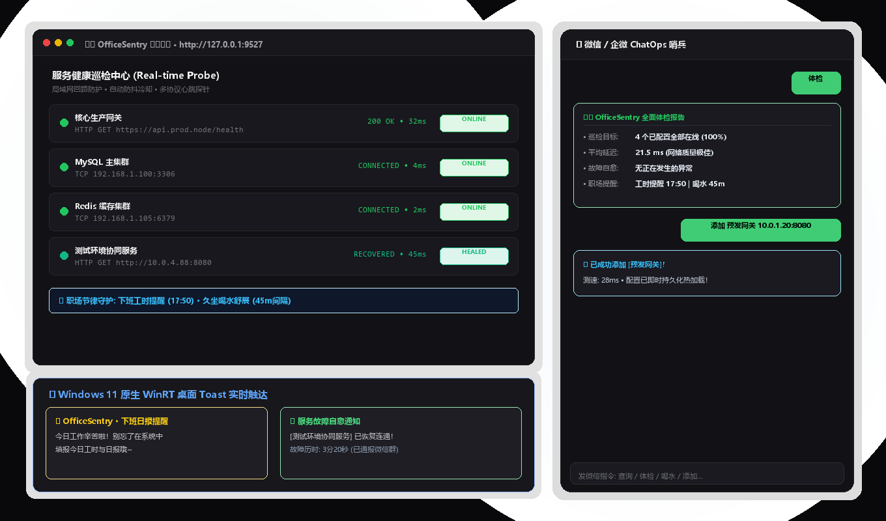

# 🛡️ OfficeSentry 办公协同哨兵

<div align="center">

[](LICENSE)
[](https://www.python.org/)
[](https://github.com/)
[](https://www.docker.com/)
[](https://github.com/)

**面向现代办公与研发团队的轻量级自动化巡检、故障自愈通报与协同提醒助手。**  
支持 **Windows 桌面原生 Toast 弹窗** 与 **微信 / 钉钉 / 飞书** 双通道触达，支持群内或微信对话 **ChatOps 查增改配置**。

[功能特性](#-功能特性) • [快速开始](#-快速开始) • [ChatOps 指令](#-chatops-聊天指令) • [Docker 部署](#-docker--云服务器部署) • [安全隔离说明](#-安全与隐私防护)

</div>

<p align="center">
  
</p>

---

## 🌟 核心特性

- 🎯 **多协议心跳探针 (服务与端口巡检)**
  - 支持 **HTTP/HTTPS** 接口探测（状态码校验、响应关键词匹配、自定义 Headers、毫秒级耗时统计）。
  - 支持 **TCP 端口** 连通性探测（MySQL/Oracle/PostgreSQL 数据库、Redis 缓存、MQ 端口）。
- 🔔 **双通道协同通知 (工位 + 手机)**
  - **工位桌面**：Windows 10/11 原生 WinRT Toast 弹窗（静音/带声，不遮挡操作）。
  - **移动端群/个人**：支持 **个人普通微信（微信测试号/插件）**、**企业微信机器人**、**飞书卡片**、**钉钉群 (Markdown + @提醒)**。
- 🤖 **ChatOps 机器人交互 (人话运维)**
  - 无论在微信还是在工作群，直接发送 `体检`、`查询`、`添加 <服务名> <网址>`、`删除 <服务名>` 即可完成运维，配置**即时热加载**生效！
- ⏰ **办公健康与工时节律关怀**
  - **下班日报/工时提醒**：工作日下班前桌面弹窗提醒填报工时与日志，避免遗漏。
  - **久坐喝水舒展**：工作时段定时提醒活动肩颈、喝杯温水。
- 🛡️ **智能防告警风暴与故障自愈**
  - **抖动过滤**：连续失败 $N$ 次才触发报警，杜绝偶发网络毛刺骚扰。
  - **故障冷却**：故障持续期间自动冷却（默认 15 分钟），避免被同一报警刷屏。
  - **恢复通报**：服务恢复时自动计算并推送故障历时（如“历时 3分20秒”）与绿色自愈通报。
- 🎨 **小白傻瓜式可视化 Web 控制台**
  - 双击 `配置助手.bat` 自动唤起浏览器，开关切换、一键测速、测试推送，零门槛上手。

---

## 🚀 快速开始 (Windows 本地环境)

### 1. 克隆代码与安装依赖

```bash
git clone https://github.com/Mianm-l/office-sentry.git
cd office-sentry

# 安装轻量依赖
pip install -r requirements.txt
```

### 2. 运行与体验

| 操作模式 | 脚本指令 | 适用场景 |
| :--- | :--- | :--- |
| **🎨 打开可视化配置后台** | 双击 `配置助手.bat` (或 `config_ui.bat`) | 网页可视化配置监控项、Webhooks、提醒时间 |
| **🚀 前台运行哨兵** | 双击 `run.bat` (或 `python main.py`) | 首次调试、查看彩色控制台巡检日志 |
| **🥷 后台静默无感常驻** | 双击 `start.bat` | **推荐**！无黑色控制台黑框打扰，静默守护 |
| **🛑 停止后台哨兵** | 双击 `stop.bat` | 安全终止后台常驻进程与释放端口 |
| **⚡ 开机自动静默运行** | 双击 `add_to_startup.bat` | 一键添加至 Windows 开机启动项，开机自启 |

---

## 🤖 ChatOps 聊天指令

直接在**个人微信公众号、钉钉群、飞书群**或**本地网页调试窗**中发送以下文本即可：

| 想要做什么 | 指令示例 | 说明 |
| :--- | :--- | :--- |
| **即时全面体检** | `体检` 或 `状态` | 立即对所有已启用的目标测速，汇报健康状态与响应毫秒 |
| **查询监控清单** | `查询` 或 `列表` | 列出目前在监控的所有目标、协议、状态及提醒时间 |
| **动态添加监控** | `添加 生产网关 http://192.168.1.50:8080/health`<br>`添加 测试库 192.168.1.100:3306` | 支持 HTTP 与 TCP 端口，**当场测速并持久化保存**，下周期自动轮询！ |
| **删除指定监控** | `删除 生产网关` | 秒删指定监控项并通知结果 |
| **快捷开启/停用** | `停用 生产网关` / `启用 生产网关` | 临时暂停或恢复报警 |
| **调整工时提醒** | `工时提醒 18:00` | 修改每日下班提醒时间 |
| **调整喝水间隔** | `喝水 45` | 修改喝水舒展提醒频率（分钟） |
| **查看帮助菜单** | `帮助` | 查看完整指令使用说明 |

---

## 🐳 Docker / 云服务器部署 (24小时不关机)

如果你有一台 Linux 云服务器（腾讯云/阿里云/自建服务器），可直接使用 Docker 容器化运行：

### 方式一：Docker Compose（推荐）

```bash
# 1. 复制配置模板
cp config.example.json config.json

# 2. 一键启动
docker-compose up -d

# 3. 查看运行日志
docker-compose logs -f
```

### 方式二：标准 Docker 构建

```bash
docker build -t office-sentry:latest .
docker run -d \
  --name office-sentry \
  --restart always \
  -p 9527:9527 \
  -v $(pwd)/config.json:/app/config.json \
  office-sentry:latest
```

---

## 📱 手机端接入指引 (个人微信 / 钉钉 / 飞书)

### 1. 手机【个人普通微信】直接对话 (微信公众平台测试号)
- 登录 [微信公众平台接口测试帐号](https://mp.weixin.qq.com/debug/cgi-bin/sandbox?t=sandbox/login)（微信扫码秒登）。
- 「接口配置信息」填入：
  - **URL**：`http://<你的公网IP或穿透域名>:9527/webhook/wechat-mp`
  - **Token**：`OfficeSentry`
- 点击提交成功后，扫码关注页面底部的二维码，即可直接在手机普通微信里与哨兵对话！

### 2. 钉钉群机器人 (Outgoing 模式)
- 钉钉群设置 -> 机器人 -> 自定义机器人 -> 勾选 **Outgoing**。
- POST 地址填：`http://<你的IP或域名>:9527/webhook/dingtalk`。
- 在群里 `@机器人 体检` 即可收到精美 Markdown 巡检卡片！

### 3. 企业微信与微信插件
- 支持标准企业微信自建应用回调：`http://<你的IP或域名>:9527/webhook/wecom-app`（支持官方 AES-256-CBC 加密通信）。

---

## 🔒 安全与隐私防护

- 🛡️ **管理后台本地物理隔离 (Localhost-Only)**：控制台与所有配置修改接口强制校验客户端来源，**只有本机 `127.0.0.1` 拥有管理权限**；外部公网扫描访问一律返回 `403 Forbidden`！
- 🔐 **密码学强验签与加解密**：微信/企微请求严格校验官方私钥签名，任何伪造与重放攻击直接在第一行拦截抛弃。
- 🧱 **探针沙箱安全**：巡检引擎完全基于 Python 标准网络栈，**严禁任何系统 Shell/CMD 脚本执行**，杜绝远程命令执行（RCE）漏洞。
- 🚫 **脱敏开源**：代码与示例配置均已彻底脱敏，绝不上传任何个人私钥与内网地址。

---

## 📄 开源许可证

本项目基于 [MIT License](LICENSE) 开源，欢迎自由使用、修改与商用。
